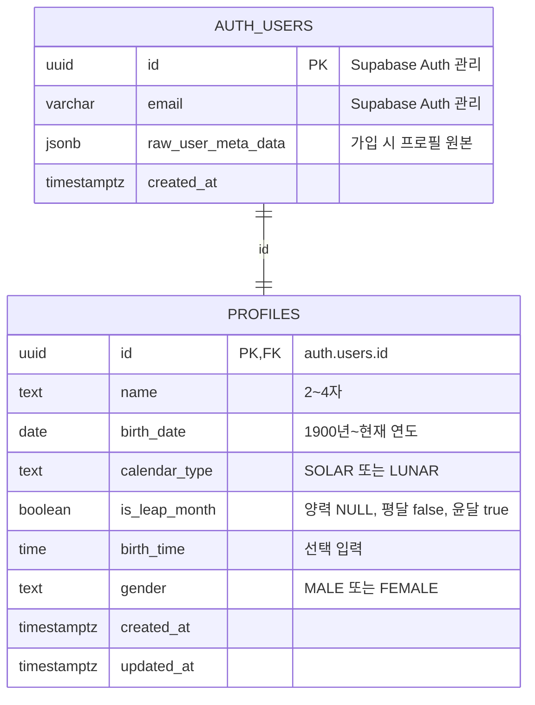

# Backend ERD

## 회원 인증과 프로필

`auth.users`는 Supabase Auth가 관리한다. 애플리케이션은 이 테이블에 직접 사용자를 추가하지 않는다.

`public.profiles`는 서비스에서 사용하는 회원 정보를 저장한다. 회원가입 시 전달된 metadata를 이용해 Database Trigger가 같은 사용자 ID의 프로필을 생성한다.

## 값 저장 규칙

| 필드 | 규칙 |
| --- | --- |
| `name` | 앞뒤 공백을 제거한 2~4자 |
| `birth_date` | 사용자가 선택한 양력 또는 음력 날짜를 변환하지 않고 저장 |
| `calendar_type` | `SOLAR`, `LUNAR` |
| `is_leap_month` | 양력은 `NULL`, 음력 평달은 `false`, 음력 윤달은 `true` |
| `birth_time` | 모르면 `NULL` |
| `gender` | `MALE`, `FEMALE` |

사용자는 RLS를 통해 자신의 프로필만 조회하고 수정할 수 있다. 프로필 생성은 `auth.users` 생성 Trigger만 담당한다.
