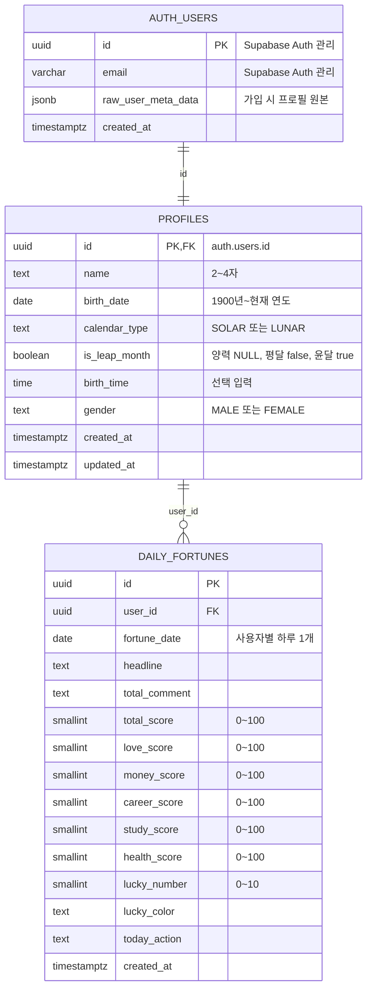
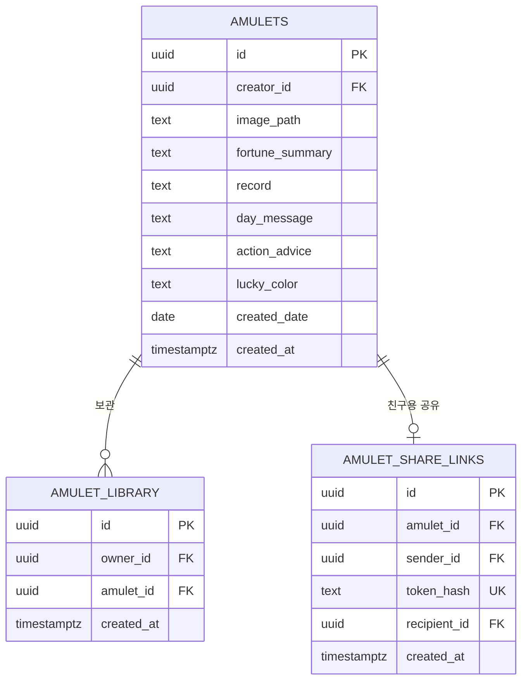

# Backend ERD

## 회원 인증과 프로필

`auth.users`는 Supabase Auth가 관리한다. 애플리케이션은 이 테이블에 직접 사용자를 추가하지 않는다.

`public.profiles`는 서비스에서 사용하는 회원 정보를 저장한다. 회원가입 시 전달된 metadata를 이용해 Database Trigger가 같은 사용자 ID의 프로필을 생성한다.

## 값 저장 규칙

| 필드 | 규칙 |
| --- | --- |
| `name` | 앞뒤 공백을 제거한 2~4자 |
| `birth_date` | 사용자가 선택한 양력 또는 음력 날짜를 변환하지 않고 저장 |
| `calendar_type` | `SOLAR`, `LUNAR` |
| `is_leap_month` | 양력은 `NULL`, 음력 평달은 `false`, 음력 윤달은 `true` |
| `birth_time` | 모르면 `NULL` |
| `gender` | `MALE`, `FEMALE` |

사용자는 RLS를 통해 자신의 프로필만 조회하고 수정할 수 있다. 프로필 생성은 `auth.users` 생성 Trigger만 담당한다.

`public.daily_fortunes`는 사용자별 오늘 운세를 한국 날짜 기준으로 하루 하나만
저장한다. 인증된 사용자는 자신의 운세만 조회하고 최초 저장할 수 있으며, 저장된
운세는 수정하거나 삭제할 수 없다.

## 부적 저장·공유 — 2026-11-10 DB 적용

기존 ERD에는 인증·프로필·오늘 운세만 있다. 아래는 2026-11-10 합의한
부적 저장 구조다. 마이그레이션 `202611100001`로 실제 DB·비공개 버킷을 적용하고 권한을 검증했다. API·실제 이미지 연동 테스트는 진행표를 따른다.

- `creator_id`, `owner_id`, `sender_id`, `recipient_id`는 `auth.users.id`를 참조한다.
- 해석과 행동 조언은 기존 API와 같은 `day_message`, `action_advice`로 각각 보존한다.
- `fortune_summary`는 만들 당시 `total_comment`, `record`는 고민·친구 상황 원문이다.
- 내 부적은 본인 보관함에 저장하고 공유하지 않는다.
- 친구용 부적은 보낸 사람 보관함에 추가하지 않고, 첫 수령 계정의 보관함에만 저장한다.
- 링크당 수령 계정은 하나이며 수령 전 `recipient_id`는 비어 있다. 유효기간은 없다.
- 링크의 `amulet_id`는 유일하게 두어 같은 친구용 부적에 여러 수령 링크를 만들지 않는다.
- `(owner_id, amulet_id)`는 유일하게 두어 같은 부적을 중복 보관하지 않는다.
- 수령 계정 기록과 보관함 추가는 DB에서 한 번에 처리한다.
- 이미지는 비공개 Storage에 보관하고 DB에는 경로만 기록한다.

생성 API의 해석 결과를 모두 DB에 저장하는 것이 아니다. 사용자가 부적을 저장하거나
친구용 공유를 생성할 때 해당 부적의 결과만 저장한다.
