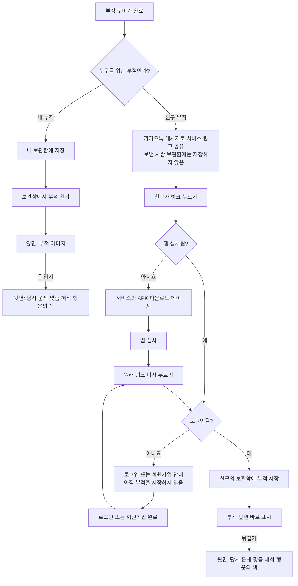

# 부적 저장·공유 초안 (SCR 1-5 / SCR 2-6)

보관함 화면·날짜·상세 표시의 확정 요구사항은 [SCR 4](SCR_4.md)를 따른다.
이 문서는 SCR 1-5 / SCR 2-6 / SCR 4가 공통으로 사용하는 저장·공유 기술 초안이다.
아래 테이블과 API는 미구현 초안이며, 확정된 정책과 구분한다.

## 확정된 저장·공유 정책

- 내 부적과 친구에게 받은 부적을 같은 보관함에 표시한다.
- 캘린더는 수령일이 아닌 부적을 만든 날짜를 기준으로 한다.
- 같은 날짜의 여러 부적은 목록에서 선택한다.
- 부적 저장 시 당시 운세 한마디·맞춤 해석·행운의 색을 보존한다.
- 직접 입력한 고민·친구 상황 원문은 저장하거나 뒷면에 표시하지 않는다.
- 공유 링크는 여러 사람이 수령할 수 있고 기간 제한을 두지 않는다.
- 같은 계정의 같은 부적 중복 저장을 방지한다.
- 부적 삭제와 링크 취소 등 작성된 범위 밖의 기능은 보류한다.
- 본인의 월간 운세는 부적과 별도로 보관하며 친구 운세를 포함하지 않는다.

## 사용자 흐름

## 데이터 초안

### `amulets` — 부적 원본

| 필드 | 용도 |
| --- | --- |
| `id` (UUID, PK) | 부적 식별자 |
| `creator_id` (UUID, FK → `auth.users`) | 부적을 만든 사용자 |
| `image_path` (text) | 비공개 Storage 버킷 안의 이미지 경로 |
| `fortune_summary` (text) | 만들 당시의 운세 한마디 |
| `meaning` (text) | 만들 당시의 맞춤 해석 |
| `lucky_color` (text) | 만들 당시의 행운의 색 |
| `created_date` (date) | 한국 날짜 기준 부적을 만든 날짜. 캘린더 조회 기준 |
| `created_at` (timestamptz) | 생성 시각 |

### `amulet_library` — 사용자 보관함

| 필드 | 용도 |
| --- | --- |
| `id` (UUID, PK) | 보관함 항목 식별자 |
| `owner_id` (UUID, FK → `auth.users`) | 보관함 소유자 |
| `amulet_id` (UUID, FK → `amulets`) | 저장한 부적 |
| `created_at` (timestamptz) | 저장 시각 |

`(owner_id, amulet_id)`를 유일하게 두어 같은 링크를 다시 눌러도 중복 저장되지 않게 한다. 내 부적은 생성 직후 본인 보관함에 넣고, 친구 부적은 수신자가 링크를 열어 수령할 때만 수신자 보관함에 넣는다.

### `amulet_share_links` — 수신 링크

| 필드 | 용도 |
| --- | --- |
| `id` (UUID, PK) | 공유 건 식별자 |
| `amulet_id` (UUID, FK → `amulets`) | 공유할 부적 |
| `sender_id` (UUID, FK → `auth.users`) | 보낸 사용자 |
| `token_hash` (text, unique) | 링크 토큰의 해시값 |
| `created_at` (timestamptz) | 생성 시각 |

링크에는 추측하기 어려운 원본 토큰을 넣고 DB에는 해시만 저장한다. 링크를 아는 로그인 사용자는 수령할 수 있다. 여러 사람이 각자 수령할 수 있고 링크에 기간 제한은 없다. 링크 취소 기능은 보류한다.

## 이미지 저장소 및 접근

- Supabase Storage에 부적 이미지용 **비공개 버킷**을 만든다. 이미지 파일 자체는 DB에 넣지 않고 `image_path`만 저장한다.
- Android가 완성된 부적 앞면을 이미지 파일로 내보내 백엔드에 전송한다. 백엔드가 파일 형식·크기를 검사하고 Storage에 올린다. 당시 운세 한마디·맞춤 해석·행운의 색을 이미지와 함께 저장한다. 고민·친구 상황 원문은 저장하지 않는다.
- 보관함 소유자만 자신의 부적 이미지와 의미를 조회할 수 있게 한다. 공유 링크의 토큰만으로 이미지에 직접 접근시키지 않는다. 수신을 완료한 사용자에게 백엔드가 짧은 유효 기간의 이미지 URL을 발급한다.
- 마이그레이션에는 세 테이블, 외래 키·유일 제약, RLS 정책, 버킷 및 Storage 접근 정책을 포함한다. 백엔드의 업로드·서명 URL 발급 권한과 비밀키 보관 방식은 구현 전에 확정한다.

## 프론트 연결용 API 초안

모든 API에는 `Authorization: Bearer {access_token}`을 사용한다. 업로드는 `multipart/form-data`로 `image`, `fortune_summary`, `meaning`, `lucky_color`, `created_date`를 보내는 초안이다. 필드 검증과 생성 날짜 처리 방식은 구현 전에 구체화한다.

| 메서드 | 경로 | 요청·결과 |
| --- | --- | --- |
| `POST` | `/amulets` | 내 부적 이미지·당시 결과 업로드 → 원본 생성과 내 보관함 저장, 부적 ID 반환 |
| `POST` | `/amulets/shares` | 친구 부적 이미지·당시 결과 업로드 → 원본과 공유 링크 생성, 카카오톡에 보낼 HTTPS URL 반환. 보낸 사람의 보관함에는 저장하지 않음 |
| `POST` | `/amulets/shares/claim` | 링크 토큰 전달 → 로그인한 수신자의 보관함에 저장, 부적 ID 반환. 같은 사용자의 재요청은 같은 결과 반환 |
| `GET` | `/amulets` | 내 보관함 목록 조회. 만든 날짜와 뒷면 정보 포함; 월·날짜 조회 규격은 구현 전에 구체화 |
| `GET` | `/amulets/{id}` | 내 보관함의 부적 앞면 이미지 URL과 당시 운세 한마디·맞춤 해석·행운의 색·만든 날짜 조회 |

Android는 카카오톡 공유 기능으로 반환된 URL을 메시지에 넣는다. 앱 링크로 들어온 토큰으로 `claim`을 호출하고, 성공하면 반환된 부적 ID로 상세 화면을 열어 앞면을 먼저 보여준다. 로그인하지 않은 상태에서는 수령 API를 호출하지 않고 재방문을 안내한다.

## 구현 전에 정할 값

- 공유 링크에 쓸 도메인과 APK 다운로드 페이지 주소
- 이미지 형식·최대 크기, 앞면 이미지의 해상도
- 카카오톡 메시지 형식과 링크를 앱에서 처리하는 방식

이 문서는 구현 방향을 정하기 위한 초안이다. 아직 마이그레이션, Storage 버킷, API는 생성하지 않았다.
